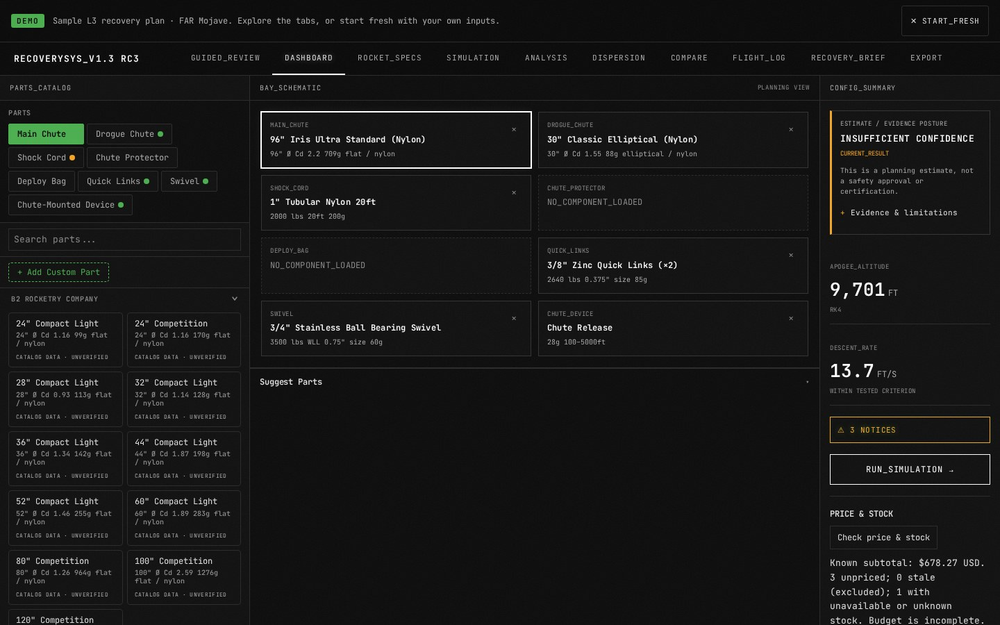
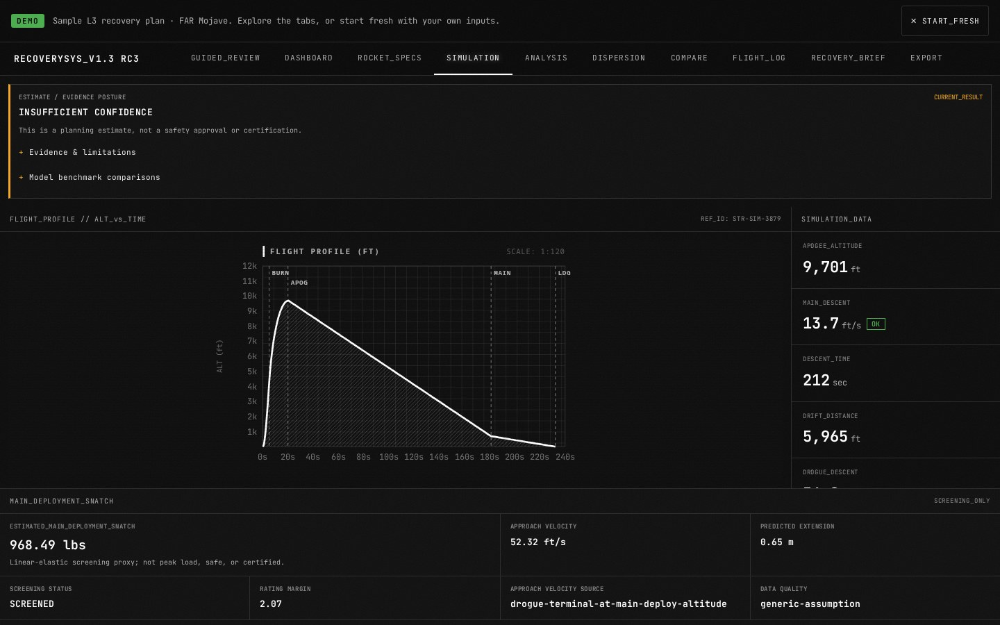
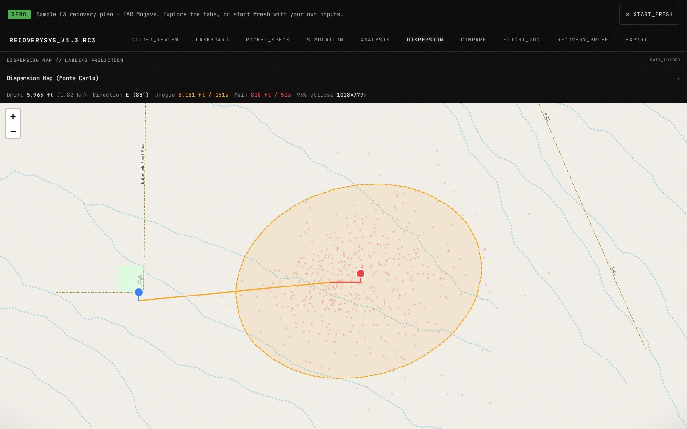
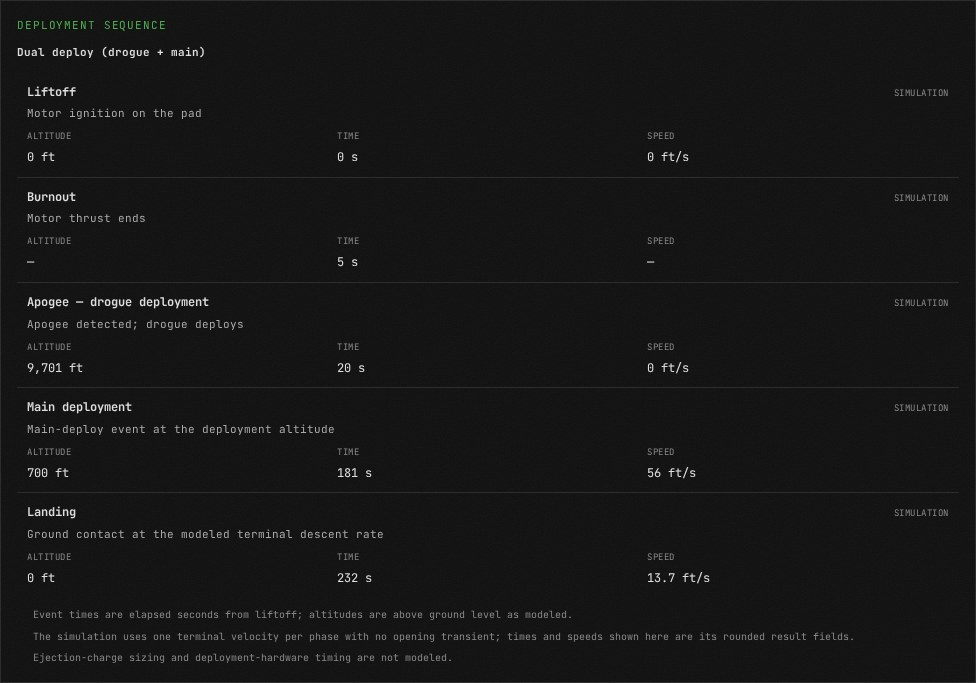
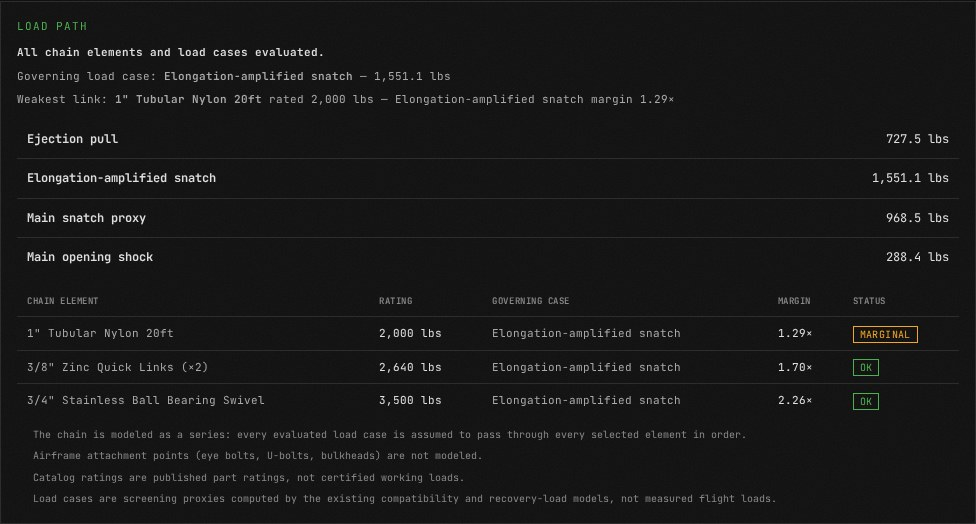

<div align="center">

# RecoverySys

**Plan, check and review a high-power rocket recovery system before launch day.**

[](https://github.com/akhan157/RecoverySys/actions/workflows/check.yml)
[](https://github.com/akhan157/RecoverySys/actions/workflows/deploy.yml)
[](https://github.com/akhan157/RecoverySys/releases/latest)
[](LICENSE)

**[Open the web app](https://akhan157.github.io/RecoverySys/)** ·
**[Download for Windows / macOS](https://github.com/akhan157/RecoverySys/releases/latest)** ·
**[Overview](https://akhan157.github.io/RecoverySys/landing/)**



</div>

RecoverySys is a free, local-first tool for high-power rocketry. Bring in a
rocket, pick parachutes and hardware, run flight estimates, and keep every
input, assumption and open finding together in one reviewable plan. There is
no account and no backend. Plans stay in your browser unless you export or
share them.

## What it does

| Feature                               | What you get                                                                                                                           |
| ------------------------------------- | -------------------------------------------------------------------------------------------------------------------------------------- |
| **Import your rocket**                | Import OpenRocket `.ork` files (formats 1.4–1.11) or enter the vehicle by hand.                                                        |
| **Choose hardware**                   | Choose from 225 catalog parachutes, cords, links, swivels, bags and devices, or add your own. Source and unverified data are labelled. |
| **Check compatibility**               | Screen packing, descent rate, landing energy, ejection, snatch and opening-shock loads across the whole cord–link–swivel chain.        |
| **Estimate the flight**               | Get ascent with ThrustCurve.org motors or a `.eng` thrust curve, plus descent, drift, Monte Carlo dispersion and sensitivity.          |
| **Follow the deployment sequence**    | See liftoff → apogee → main → landing with altitude, time and speed, taken from the current result.                                    |
| **Check hardware mass and load path** | See per-part recovery mass, the governing load case, each element's margin and the weakest link.                                       |
| **Budget**                            | See timestamped price and stock for 103 parts from Fruity Chutes, Rocketman and Spherachutes.                                          |
| **Review and share**                  | Compare configurations, print a recovery brief or checklist, export JSON, share a link and log real flights.                           |

<table>
<tr>
<td width="50%"></td>
<td width="50%"></td>
</tr>
<tr>
<td></td>
<td></td>
</tr>
</table>

## Get it

- **Web:** <https://akhan157.github.io/RecoverySys/>. It works in any modern
  browser and tracks `main`.
- **Desktop:** the portable Windows and macOS universal ZIPs are on the
  [latest release](https://github.com/akhan157/RecoverySys/releases/latest).
  No installer is needed. The macOS app is not notarized, so on first launch
  right-click it and choose **Open**. See the
  [desktop guide](RecoverySys/DESKTOP.md).

## How it is tested

Every push runs 482 unit and component tests on Node 22, 24 and 26, and 96
desktop and mobile browser workflows. It also builds the Windows and macOS apps
and drives the real desktop apps through a full plan: inputs, hardware,
simulation, Recovery Brief and saved-plan reload.

These are software checks. RecoverySys is a planning aid built on simplified
models. Its results have not been validated against accepted comparison cases
or real flights, and they do not replace independent engineering review,
manufacturer guidance or range safety procedures. See
[next steps](RecoverySys/docs/next-steps.md) for the open evidence.

## Run locally

```bash
cd RecoverySys
npm ci
npm run dev      # http://localhost:5173
npm run check    # format, catalog/corpus validation, lint, tests and build
npm run e2e      # production desktop/mobile browser workflows
```

The supported runtimes are Node `^22.13.0 || ^24.0.0 || ^26.0.0` and npm 10 or
later.

## Privacy and network use

Your plans and Flight Log stay in browser storage. The app goes online only to
search ThrustCurve.org for motors, load OpenStreetMap tiles for the dispersion
map, fetch the published supplier price snapshot, and load fonts from Google
Fonts. Supplier refreshes never
change engineering specifications. See the
[user guide](RecoverySys/README.md).

## Documentation

[User guide](RecoverySys/README.md) ·
[Desktop](RecoverySys/DESKTOP.md) ·
[Changelog](RecoverySys/CHANGELOG.md) ·
[Roadmap](RecoverySys/ROADMAP.md) ·
[Field-trial guide](RecoverySys/docs/v1-field-trial.md) ·
[Contributing](CONTRIBUTING.md) ·
[MIT license](LICENSE)

Third-party regression fixtures keep their own
[source attribution and licenses](RecoverySys/src/test/fixtures/openrocket/README.md).
