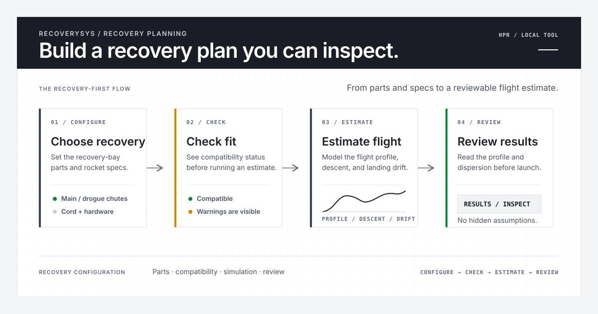

# RecoverySys

### Build a recovery plan you can review.

A local-first recovery-planning tool for high-power rocketry. Bring in a rocket, choose recovery hardware, explore flight estimates, and keep the inputs, assumptions and unresolved findings together. No account or application backend required.

**[Open the app](https://akhan157.github.io/RecoverySys/)** · **[Explore the overview](https://akhan157.github.io/RecoverySys/landing/)** · **[Download v1.3.0-rc.1](https://github.com/akhan157/RecoverySys/releases/tag/v1.3.0-rc.1)**



## From rocket file to reviewable plan

1. **Start with your rocket.** Import an OpenRocket `.ork` file or enter the vehicle manually. Review the configuration, stage, geometry and mass before accepting suggestions.
2. **Choose your hardware.** Select catalog or custom parachutes, cords, protection and connection hardware. Review source information, compatibility findings and missing data.
3. **Run and compare estimates.** Explore ascent, descent, drift, deployment-load screening and landing energy. Input changes mark existing results stale until you rerun.
4. **Keep the review with the plan.** Save locally, transfer JSON, share a link, compare configurations or print a recovery brief/checklist. Record actual observations separately in the Flight Log.

## What is available

| Capability | What you can do |
| --- | --- |
| OpenRocket import | Review bounded local imports from formats **1.4–1.11**. Accepted source identity persists through saves, JSON and share links. |
| Recovery hardware | Browse **225 catalog entries** or enter custom parts; review provenance and unresolved specifications. |
| Supplier budgeting | See timestamped price/stock for **103 distinct IDs** across Fruity Chutes, Rocketman and Spherachutes. Unknown and stale data stays visible; incomplete subtotals are labeled. |
| Motor inputs | Search ThrustCurve.org or import a RASP `.eng` thrust curve. |
| Flight estimates | Review ascent, descent, drift, load screening, landing energy and deterministic sensitivity. |
| Dispersion | Explore modeled landing scatter and drift, with assumptions visible. |
| Plan continuity | Save, reopen, compare, export, share and print; preserve current-versus-stale result status. |

Packing checks are heuristic screens. They do not measure occupied space or establish physical fit. The experimental 2D/3D viewer is deferred and is not part of V1.

## Current test release

**[v1.3.0-rc.1](https://github.com/akhan157/RecoverySys/releases/tag/v1.3.0-rc.1)** includes the web build, portable Windows ZIP, macOS universal ZIP and `SHA256SUMS.txt`. See [desktop instructions](RecoverySys/DESKTOP.md) before using a portable build.

The candidate passed **386 tests and 62 desktop/mobile browser workflows**, plus Windows/macOS build and process-launch smoke checks. These are software checks. Manual platform workflows, observed rocketeer trials and independent engineering/flight evidence remain open. The physics corpus has no accepted comparison or real-flight cases. See the [qualification record](RecoverySys/docs/release-qualification-2026-10-19.md) for evidence and limitations, including remaining development-tool advisories.

Trying your own rocket? Use the [field-trial guide](RecoverySys/docs/v1-field-trial.md) and [results template](RecoverySys/docs/field-trial-results.csv).

## Local first, with explicit network features

Plans and Flight Log entries stay in browser storage unless you export or share them. Motor searches use ThrustCurve.org; map tiles use OpenStreetMap; checking supplier data downloads the published commercial snapshot. Supplier refreshes never rewrite engineering specifications or saved simulation inputs. The landing page and fonts also load public CDN resources. See [privacy and model details](RecoverySys/README.md).

RecoverySys is a planning aid. Results depend on simplified models and input quality; they do not authorize a launch or replace independent engineering review, manufacturer guidance or range procedures.

## Run locally

Use Node 22 for the CI-qualified development path. The package supports Node `^20.19.0 || ^22.13.0 || >=24.0.0` and npm `>=10`.

```bash
cd RecoverySys
npm ci
npm run dev
```

```bash
npm run check   # formatting, catalog/corpus validation, lint, tests and build
npm run e2e     # production desktop/mobile browser workflows
npm run preview # preview the built application
```

## Project documentation

- [User guide](RecoverySys/README.md) · [Desktop downloads and builds](RecoverySys/DESKTOP.md)
- [Current next steps](RecoverySys/docs/next-steps.md) · [Roadmap](RecoverySys/ROADMAP.md) · [Changelog](RecoverySys/CHANGELOG.md)
- [Product strategy](RecoverySys/PRODUCT-STRATEGY-BRIEF.md)
- [Supplier refresh and engineering review](RecoverySys/docs/supplier-refresh.md)
- [Contributing](CONTRIBUTING.md) · [MIT license](LICENSE)

Third-party regression fixtures retain their own [source attribution and licenses](RecoverySys/src/test/fixtures/openrocket/README.md).
